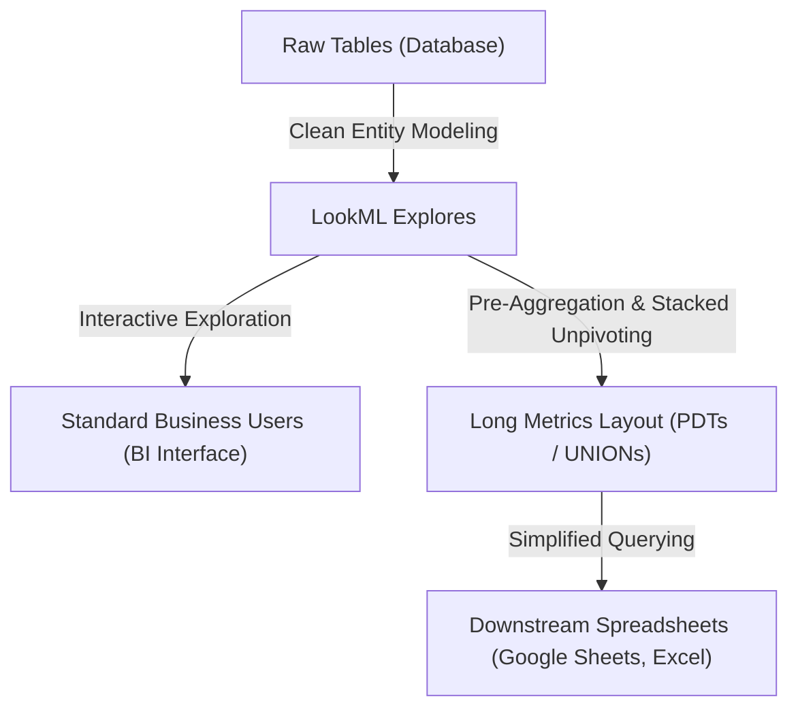

# Long Metrics Table

This example shows how to model LookML views for a long metrics table (narrow format). The pattern keeps core data models clean for standard Looker exploration while providing a simplified interface for financial reporting and external spreadsheet tools.

Standard LookML modeling handles core data like order items, products, and users with normalized relationships and standard measures. Business analysts can explore granular data interactively in Looker without clutter.

For external tools like Google Sheets, Excel, or Coefficient, a pre-aggregated long metrics table view sits on top of the core models.

Instead of adding wide columns for every combination of metric and timeframe, the long metrics layout unpivots data into standard dimensions:

Timeframes, period alignments, and metric names become standard dimensions.
A single value column exposes numerical data.
Looker re-measures the value field using measures (`type: sum`) filtered by the metric dimension.

Spreadsheet users can build pivot tables or filter by metric and timeframe without writing custom formulas or complex Looker dimensions.

Within Looker, this layout works directly with the native [Table visualization](https://cloud.google.com/looker/docs/table-next-visualizations) and the [lkr.dev Report Table visualization](https://lkr.dev/docs/visualizations/viz-report-table-marketplace2) to construct dynamic financial reports by pivoting on metrics and timeframes.

## Modeling Hierarchy

Data moves from transactional tables to downstream spreadsheets through three distinct layers:

| Layer | Structure / Format | Purpose | Target Audience | Example |
| :--- | :--- | :--- | :--- | :--- |
| Raw Tables | Transactional tables in the database. | Granular storage of record. | DBAs, Data Engineers | `order_items` (`order_id`, `product_id`, `sale_price`, `created_at`) |
| LookML Explores | Normalized relationships, joins, and declarative measures. | Business logic definition and ad-hoc queries. | BI Developers, Data Analysts | `explore: order_items` joining `products` |
| Long Metrics Layout | Pre-aggregated, unpivoted key-value records. | Static, simplified slices for external tools. | Finance Teams, Spreadsheet Users | `long_metrics` (`date`, `category`, `metric`, `timeframe`, `value`) |

## Wide Layout vs. Long Metrics Layout

### Wide Layout (Standard Fact Table)

Adding new timeframes or metrics to a wide layout requires adding new columns and measures to the model:

| Date | Product Category | Total Sale Price (7D) | Total Sale Price (28D) | Gross Margin (7D) |
| :--- | :--- | :--- | :--- | :--- |
| 2026-07-06 | Electronics | \$1,000 | \$3,500 | \$200 |

### Long Metrics Layout

In a long metrics layout, metrics and timeframes are rows instead of columns:

| Date | Product Category | Metric | Timeframe | Value |
| :--- | :--- | :--- | :--- | :--- |
| 2026-07-06 | Electronics | Total Sale Price | r7d | 1000 |
| 2026-07-06 | Electronics | Total Sale Price | r28d | 3500 |
| 2026-07-06 | Electronics | Total Gross Margin | r7d | 200 |

## File Structure

The workspace contains the following core files:

- [.agents/skills/long-metrics-table/SKILL.md](.agents/skills/long-metrics-table/SKILL.md) provides detailed instructions on adding metrics, dimensions, and post-aggregation calculations.
- [long-metrics.view.lkml](long-metrics.view.lkml) defines the base aggregation fields, metric-specific SQL window functions, and stacked `UNION ALL` queries.
- [thelook.model.lkml](thelook.model.lkml) defines the `order_items` explore used as the data source.

## Developing with AI Agents

An agent skill is located at [.agents/skills/long-metrics-table/SKILL.md](.agents/skills/long-metrics-table/SKILL.md) to guide AI coding assistants when expanding this pattern. 

Tools like [Antigravity](https://antigravity.google) and other AI coding assistants use this skill to maintain consistency across edits. For a step-by-step walkthrough, see the Google Codelab [Author LookML with Agentic Coding Tools](https://codelabs.developers.google.com/next26/looker-agentic-lookml).
