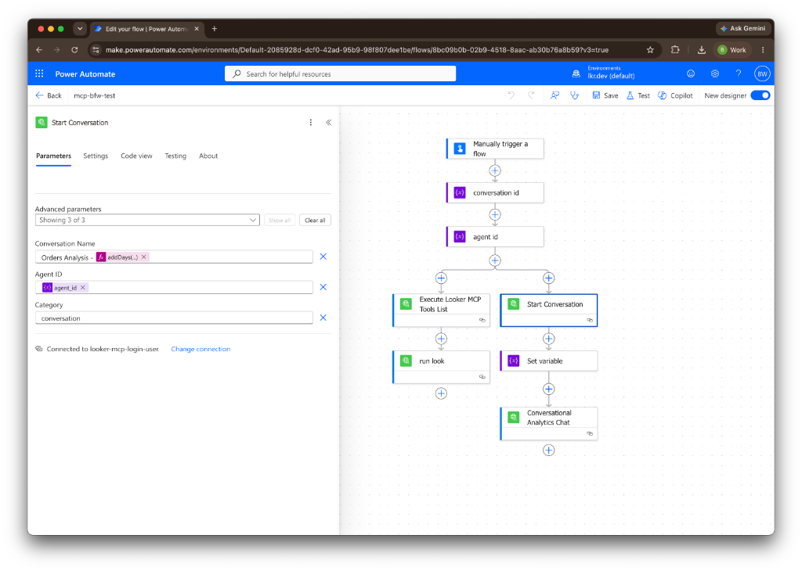

# Looker MCP and AI Agents Custom Connector for Microsoft Power Platform

Custom Connector for Microsoft Power Automate, Power Apps, and Copilot Studio. Connects Power Platform flows to Looker MCP tools (`/mcp`) and AI Agent conversation endpoints (`/api/4.0/`) using OAuth 2.0 authentication.

## Features

- Authenticates requests with OAuth 2.0 access tokens using `Authorization: Bearer <access_token>`.
- Executes `/mcp` queries including `tools/list` and `tools/call` actions like `run_look`.
- Connects to AI Agent endpoints to list agents, start conversations, and exchange messages.
- Passes through user OAuth access tokens directly without requiring service account admin credentials or `login_user` impersonation.

## Prerequisites

- Access to a Looker instance.
- The [Looker OAuth 2.0 Access Token Proxy](oauth-2-access-token/README.md) running locally or deployed to serve OAuth 2.0 authentication.

## Looker OAuth 2.0 Access Token Proxy

The [oauth-2-access-token](oauth-2-access-token/README.md) directory contains a Node.js proxy service designed for Looker API integration with Power Automate and custom connectors.

### Implementation Details
- Acts as an OAuth 2.0 authorization server between Power Platform and Looker, handling 3-legged PKCE authorization flows, AES-256-GCM payload encryption, and Looker user token generation via `login_user`.
- Connects custom connectors using standard RFC 6749 OAuth 2.0 authorization code and token endpoints (`/oauth/authorize` and `/oauth/token`).
- Authenticates individual users via Looker login and dynamically issues 60-minute user-specific access tokens (`login_user`).
- Returns `expires_in: 3600` responses so Power Automate handles background token refresh and HTTP 401 retries automatically.
- Rejects token requests for disabled or deleted Looker users with HTTP 400 `invalid_grant`, causing Power Automate to invalidate the connection and halt flow execution.

Setup and configuration details are in [oauth-2-access-token/README.md](oauth-2-access-token/README.md).

## Setup Instructions

### Import the Custom Connector

1. Open Power Automate or Power Apps.
2. Navigate to **Custom Connectors**, select **New custom connector**, then choose **Import an OpenAPI file** (or OpenAPI URL).
3. Select [looker_mcp_single_endpoint_swagger.yaml](looker_mcp_single_endpoint_swagger.yaml) and click **Continue**.
4. Configure the custom code script on the **Code** tab:
   - Toggle **Code Enabled** to `On`.
   - Under **Code File**, upload or paste the contents of [Script.cs](file:///usr/local/google/home/bryanweber/lkrdev/examples/power_platform_looker_mcp/Script.cs).
   - Under **Actions**, select all operations so the script processes all connector requests.
5. Select **Update connector** (or **Create connector**).

### Create and Authenticate the Connection

1. Go to **Connections** in Power Automate.
2. Select **New Connection**.
3. Choose the Looker connector and log in using OAuth 2.0 when prompted.
4. Select **Create connection**.

### Connection Sharing and Permissions

In Power Platform, custom connector connections execute based on how ownership and run-only permissions are configured:

- Shared flow connections execute in Looker under the owner's identity. If that owner's Looker account is disabled or revoked, the connection breaks for all users of the flow until re-authenticated with an active user account.
- For team flows or canvas apps, set the custom connector connection under **Run-only users** to **Provided by run-only user**. Each user signs in with their own Looker account so actions execute strictly within their individual Looker roles and permissions.

### Import Example Power Automate Flow

An example Power Automate flow package is included for download:
- [example-mcp-ca_20260728074343.zip](example-mcp-ca_20260728074343.zip)



To import the flow:
1. In Power Automate, navigate to **My flows**.
2. Select **Import** -> **Import Package (Legacy)**.
3. Upload [example-mcp-ca_20260728074343.zip](example-mcp-ca_20260728074343.zip).
4. Map the imported flow to your configured Looker custom connector connection and select **Import**.


## Using MCP Tools in Power Automate

### List Available Tools

Add the Execute Looker MCP action. Leaving the raw body empty automatically executes `tools/list`.

Optional payload:
```json
{
  "jsonrpc": "2.0",
  "id": "1",
  "method": "tools/list",
  "params": {}
}
```

Response example:
```json
{
  "jsonrpc": "2.0",
  "id": "1",
  "result": {
    "tools": [
      {
        "name": "run_look",
        "description": "Executes a saved Look by ID"
      },
      {
        "name": "get_dimensions",
        "description": "Retrieves dimensions for an explore"
      }
    ]
  }
}
```

### Execute an MCP Tool

Pass the tool invocation JSON into the Raw Body of the Execute Looker MCP action.

Request payload:
```json
{
  "jsonrpc": "2.0",
  "id": "2",
  "method": "tools/call",
  "params": {
    "name": "run_look",
    "arguments": {
      "look_id": "25"
    }
  }
}
```

Response example:
```json
{
  "jsonrpc": "2.0",
  "id": "2",
  "result": {
    "content": [
      {
        "type": "text",
        "text": "[{\"order_items.count\":260,\"order_items.total_sale_price\":34646.69,\"products.category\":\"Outerwear & Coats\"}]"
      }
    ]
  }
}
```

## Using AI Agents and Conversations in Power Automate

### List Available Agents

Add the List / Search Agents action to query active agents and select an `agent_id`.

### Start a Conversation

Add the Start Conversation action and pass `agent_id` in the request body.

Request body:
```json
{
  "name": "Power Automate Session",
  "agent_id": "81d628f8b7564ae38a9659ce049cb905",
  "category": "conversation"
}
```

Response output:
```json
{
  "id": "965bbb961bba4520b97170a822f17600",
  "name": "Power Automate Session",
  "agent_id": "81d628f8b7564ae38a9659ce049cb905"
}
```

### Post a Prompt Message

Add the Post Conversation Message action with `conversation_id` from the previous step.

Request body:
```json
{
  "messages": [
    {
      "type": "user",
      "message": {
        "text": "What were our top 5 selling product categories last month?"
      }
    }
  ]
}
```

Response output:
```json
[
  {
    "id": "32c94f0b9681464d8639220ee512af82",
    "type": "user",
    "message": {
      "text": "What were our top 5 selling product categories last month?"
    },
    "order": 1
  }
]
```
