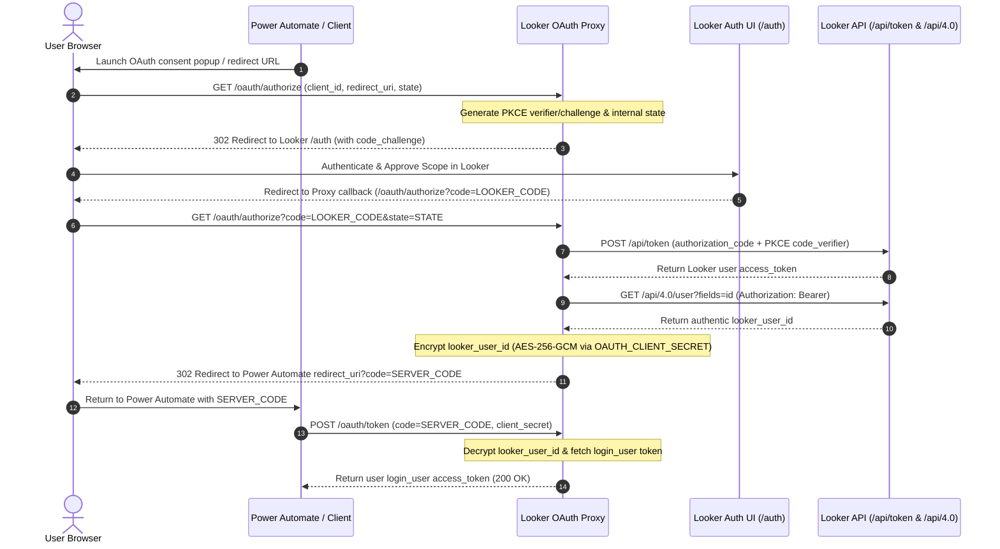
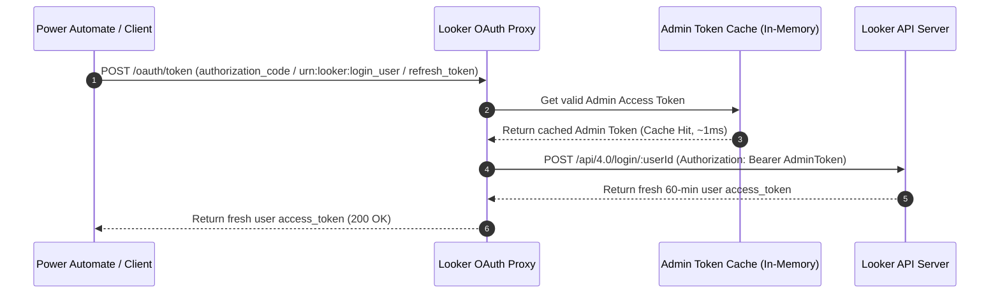

# Looker OAuth 2.0 Access Token Proxy

An OAuth 2.0 access token proxy service for Looker API integrations with Power Automate, Azure API Management (APIM), custom connectors, and HTTP clients.

This service functions as an OAuth 2.0 authorization server for external tools. It links identity resolution to Looker using standard PKCE 3-legged browser authorization, AES-256-GCM payload encryption, and Looker SDK user impersonation (`login_user`).

## Initial PKCE Authorization Flow



## On-Demand User Token Generation and Admin Token Caching

Power Automate caches the user access token locally for 60 minutes based on `"expires_in": 3600`, so the proxy does not store non-admin user tokens in memory. The proxy caches only the base admin API token to authorize on-demand `login_user` calls to Looker.



## Token Expiration Handling

Power Automate and external OAuth clients track token expiration through three primary mechanisms:

1. The `POST /oauth/token` response includes `"expires_in": 3600`. Per the [Microsoft Power Platform Custom Connector Documentation](https://learn.microsoft.com/en-us/connectors/custom-connectors/connection-parameters), Power Automate uses `expires_in` to calculate token expiration and schedule background token refreshes automatically.
   ```json
   {
     "access_token": "eyJhbGciOi...",
     "token_type": "Bearer",
     "expires_in": 3600,
     "scope": "user_api",
     "looker_user_id": "42"
   }
   ```
2. Every token request generates a new 60-minute (3,600 second) opaque user access token directly from Looker. Per the official [Looker API Authentication Documentation](https://cloud.google.com/looker/docs/api-auth), Looker API 4.0 access tokens have a default lifetime of 3,600 seconds (1 hour). Power Automate receives `expires_in` during the OAuth token exchange and manages token renewals internally, forwarding only the bare `Authorization: Bearer <access_token>` header to downstream custom connector C# scripts.
3. If a token expires during execution, Power Automate catches the HTTP 401 response, calls `POST /oauth/token` for a new token, and retries the request.

## Step-by-Step Execution

1. Power Automate prompts the user with an authorization link to create a connection.
2. The user browser opens `GET /oauth/authorize` on the proxy with `client_id`, `redirect_uri`, and `state`.
3. The proxy generates a random 32-byte PKCE `code_verifier` and SHA-256 `code_challenge`, stores state, and redirects to Looker `/auth`.
4. The user logs into Looker and approves the access request.
5. Looker redirects back to proxy endpoint `/oauth/authorize?code=LOOKER_CODE&state=STATE`.
6. The proxy sends a `POST /api/token` request to Looker with `grant_type=authorization_code` and the PKCE `code_verifier`.
7. The proxy fetches `GET /api/4.0/user?fields=id` using the user access token to resolve the Looker `user_id`.
8. The proxy encrypts `{ looker_user_id, createdAt }` with AES-256-GCM using `OAUTH_CLIENT_SECRET` and maps it to a single-use proxy code.
9. The proxy redirects the browser back to Power Automate with the proxy code.
10. Power Automate calls `POST /oauth/token` with the proxy code and `OAUTH_CLIENT_SECRET`.
11. The proxy decrypts the `looker_user_id`, calls `tokenManager.getUserToken(looker_user_id)`, and returns the user token.

## Encrypted Data Payload Structure

The proxy encrypts the Looker user identity into a signed data payload attached to the authorization code.

### Plaintext Payload Object
```json
{
  "looker_user_id": "42",
  "createdAt": 1785191363560
}
```

### Encryption Parameters
- Cipher: `aes-256-gcm`
- Key derivation: SHA-256 hash of `OAUTH_CLIENT_SECRET` (32 bytes)
- Initialization vector: 12 random bytes
- Auth tag: 16 bytes

### Serialized Format
The payload uses a colon-separated format:
```
<12-byte-IV-hex>:<16-byte-AuthTag-hex>:<EncryptedData-hex>
```

Example:
`d4f18a2e9b0c:8a1b2c3d4e5f6a7b8c9d0e1f:a3f912e70c8d1e345b6a78901c`

### Decryption Flow in POST /oauth/token
1. Retrieve the encrypted payload for the provided authorization code.
2. Decrypt the payload with `OAUTH_CLIENT_SECRET` and verify the GCM authentication tag.
3. If decryption fails or `looker_user_id` is missing, return HTTP 400 `invalid_grant`.
4. If valid, call `tokenManager.getUserToken(decrypted.looker_user_id)` to issue the token.

## Custom Connector Configuration

Configure custom connector security settings with these parameters:

- Identity Provider: Custom / OAuth 2.0
- Client ID: Value of `OAUTH_CLIENT_ID`
- Client Secret: Value of `OAUTH_CLIENT_SECRET`
- Authorization URL: `https://<your-issuer-domain>/oauth/authorize`
- Token URL: `https://<your-issuer-domain>/oauth/token`
- Refresh URL: `https://<your-issuer-domain>/oauth/token`
- Scope: `user_info api` (or leave empty)

After saving the connector, add the generated redirect URI to `ALLOWED_REDIRECT_URIS` in `.env`.

### Connection Sharing & Power Platform Permissions

- Shared flow connections established by a single owner will request tokens for that owner's Looker user ID. If the owner account is disabled or revoked, the connection fails for all users of the flow.
- To enforce individual Looker permissions in multi-user apps or team flows, set the custom connector connection to **Provided by run-only user**. Each user authenticates through the proxy with their own Looker credentials to generate isolated user-scoped access tokens.

## Security Controls

- The `client_credentials` grant type is disabled on `POST /oauth/token`.
- Looker API credentials (`LOOKERSDK_CLIENT_ID` and `LOOKERSDK_CLIENT_SECRET`) must belong to an admin user with `sudo` permission (which enables API user impersonation via `login_user`).
- User identity is resolved strictly from Looker OAuth sign-in.
- Authorization codes contain AES-256-GCM encrypted user payloads.
- Non-admin user tokens are generated on demand without proxy storage.

## Prerequisites

- Node.js (v18 or higher) and `npm` (or `nvm` to manage Node versions).
- Admin API credentials for Looker (`LOOKERSDK_CLIENT_ID` & `LOOKERSDK_CLIENT_SECRET`) with `sudo` permission.

## Environment Variables

| Variable | Required | Default | Description |
| --- | --- | --- | --- |
| `LOOKERSDK_BASE_URL` | Yes | — | Base URL of your Looker instance |
| `LOOKERSDK_CLIENT_ID` | Yes | — | Looker API 4.0 Client ID (admin API key) |
| `LOOKERSDK_CLIENT_SECRET` | Yes | — | Looker API 4.0 Client Secret (admin API secret) |
| `OAUTH_CLIENT_ID` | No | `looker-oauth-client-id` | Registered OAuth Client ID for external tools |
| `OAUTH_CLIENT_SECRET` | No | `looker-oauth-client-secret` | OAuth Client Secret for payload encryption and client auth |
| `OAUTH_ISSUER_URL` | No | Auto-detected | Public base URL used for discovery metadata |
| `ALLOWED_REDIRECT_URIS` | No | — | Comma-separated list of allowed callback redirect URIs |
| `ENABLE_FILE_LOGGING` | No | `false` | Enable writing HTTP request logs to `log.jsonl` |
| `HOST` | No | `127.0.0.1` | Network interface binding address |
| `PORT` | No | `3000` | HTTP port |

## Setup and Management Commands

### Interactive Wizard
Run the setup wizard to verify credentials and generate configuration settings:
```bash
npm run setup
```

### Register OAuth Callback
Register or update the callback redirect URI in Looker via the SDK:
```bash
npm run looker:register-oauth
```

## Production Deployment

Deployment instructions for GCP Cloud Run, Cloud Functions, Azure App Service, and Azure Functions are documented in [DEPLOYMENT.md](DEPLOYMENT.md).

## API Reference

### Discovery Endpoints
- `GET /oauth/identity`
- `GET /.well-known/oauth-authorization-server`
- `GET /.well-known/openid-configuration`

Example response:
```json
{
  "issuer": "https://your-tunnel.trycloudflare.com",
  "token_endpoint": "https://your-tunnel.trycloudflare.com/oauth/token",
  "token_url": "https://your-tunnel.trycloudflare.com/oauth/token",
  "authorization_endpoint": "https://your-tunnel.trycloudflare.com/oauth/authorize",
  "client_id": "looker-oauth-client-id",
  "scopes_supported": ["user_info", "api", "login_user"],
  "grant_types_supported": [
    "authorization_code",
    "urn:looker:login_user",
    "refresh_token"
  ],
  "response_types_supported": ["token", "code"],
  "token_endpoint_auth_methods_supported": [
    "client_secret_post",
    "client_secret_basic"
  ]
}
```

### Authorization Endpoint (`GET /oauth/authorize`)
Initiates the PKCE flow with Looker `/auth` and handles the callback exchange to resolve user identity.

### Token Endpoint (`POST /oauth/token`)

Exchange code for token (`grant_type=authorization_code`):
```http
POST /oauth/token
Content-Type: application/x-www-form-urlencoded

grant_type=authorization_code&code=SERVER_CODE&client_id=looker-oauth-client-id&client_secret=your_secret
```

Response:
```json
{
  "access_token": "eyJhbGciOi...",
  "token_type": "Bearer",
  "expires_in": 3600,
  "scope": "user_api",
  "looker_user_id": "42"
}
```

Direct user impersonation (`grant_type=urn:looker:login_user`):
```json
{
  "grant_type": "urn:looker:login_user",
  "user_id": "42",
  "client_id": "looker-oauth-client-id",
  "client_secret": "your_secret"
}
```

### Revocation Endpoint (`POST /oauth/revoke`)
Returns HTTP 501 Not Implemented.

## Troubleshooting

### Redirect URI Mismatch (HTTP 400)
Looker `/auth` received a redirect URI that does not match the registered callback.
1. Update `OAUTH_ISSUER_URL` in `.env`.
2. Run `npm run looker:register-oauth`.
3. Restart the proxy process.
4. Update authorization URL in custom connector settings.

### Login User Failed (HTTP 403 or 404)
Looker API credentials do not belong to an admin user or lack `sudo` (`login_user`) permissions. Generate new API keys from an admin user account in Looker (**Admin -> Users -> API Keys**).

### Disabled or Revoked Looker User Accounts
If a Looker user account is disabled or deleted in Looker:
1. Looker's `POST /api/4.0/login/:userId` endpoint rejects the token request with HTTP 403/404 ("User is disabled").
2. The proxy returns an HTTP 400 `invalid_grant` error response to Power Automate.
3. Power Automate automatically marks the user's connection as unauthenticated, halting active flow or app executions for that account.

### Port 3000 Collision (`EADDRINUSE`)
Another process is listening on port 3000. Run `npm start` to execute port cleanup, or manually terminate the process:
```bash
kill -9 $(lsof -t -i:3000)
```

### Redirect URI Not Authorized
The client callback URI is missing from `ALLOWED_REDIRECT_URIS`. Add the URI to `ALLOWED_REDIRECT_URIS` in `.env`.

## Local Commands

Run unit tests:
```bash
npm test
```

Start the proxy server:
```bash
npm start
```

Start Cloudflare Tunnel with redundant connections:
```bash
cloudflared tunnel --ha-connections 4 --url http://127.0.0.1:3000
```
